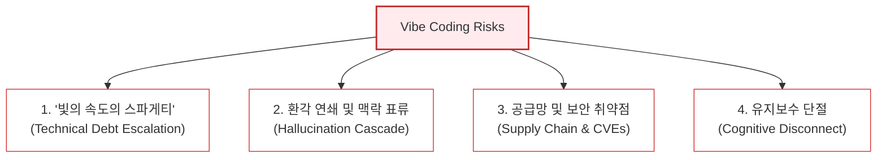
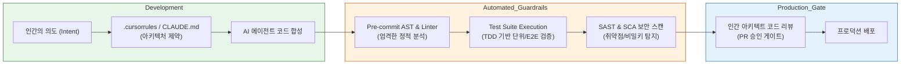

# [기술 보고서] 바이브 코딩(Vibe Coding)의 엔지니어링 분석 및 엔터프라이즈 도입 전략

* **문서 번호**: TR-2026-AI-003  
* **작성자**: 시니어 AI 엔지니어 / AI 아키텍트  
* **분류**: 소프트웨어 공학 / 생성형 AI / 개발 생산성  
* **상태**: 최종 승인본 (Approved)  

---

## 1. Executive Summary (요약)

2025년 초 촉발된 **'바이브 코딩(Vibe Coding)'** 트렌드는 전통적인 소프트웨어 엔지니어링(SWE)의 코드 작성(Authoring) 방식을 근본적으로 재편하고 있다. 이는 단순한 코드 자동완성(Autocomplete)을 넘어, **'자연어 명세(Specification)와 의도(Intent)를 입력받아 AI 에이전트가 코드를 합성(Synthesis)하고, 실행 환경과 상호작용하며 자가 치유(Self-Healing)하는 자율 개발 패러다임'**으로 정의된다.

본 보고서는 시니어 AI 엔지니어의 관점에서 바이브 코딩의 기술적 기저 메커니즘을 해체하고, 실제 프로덕션 환경 도입 시 발생할 수 있는 잠재적 리스크(기술 부채, 보안 취약점, 환각 연쇄)를 정량적/정성적으로 분석하며, 엔터프라이즈 레벨에서 이를 안전하게 내재화하기 위한 **'가드레일 기반 엔지니어링 프레임워크'**를 제시한다.

---

## 2. 기술적 정의 및 동작 메커니즘 (Technical Architecture)

### 2.1 전통적 개발 vs 바이브 코딩 시스템 비교

```
[전통적 SWE]
Human (Design & Logic) ──> Human (Code Typing) ──> Compiler/Runtime ──> Error Trace ──> Human (Manual Debug)

[Vibe Coding Agent Architecture]
Human (Intent/Constraint) ──> [ Context Orchestrator ] 
                                      │
                                      ▼
                                [ LLM (Reasoning) ] 
                                      │  (Tool Call / MCP)
                                      ▼
                                [ File / Shell I/O ] ──> [ Sandbox Runtime ]
                                      ▲                          │ (Execution Logs)
                                      └────── [ Self-Healing Loop ]
```

### 2.2 바이브 코딩 에이전트의 4대 핵심 컴포넌트

1. **Context Engine (문맥 큐레이터)**:
   - 전체 코드베이스의 AST(추상 구문 트리), Git 히스토리, 디렉터리 구조를 인덱싱하여 모델의 주의집중(Attention) 범위 내에 최적의 청크(Chunk)를 주입.
   - 최근 초대용량 컨텍스트 윈도우(1M~2M 토큰)의 상용화로 복잡한 RAG 검색 없이 프로젝트 전체를 인메모리에 탑재 가능.
2. **Reasoning Core (추론 엔진)**:
   - CoT(Chain-of-Thought)를 통해 기능 요구사항을 컴포넌트 생성 $\rightarrow$ 의존성 주입 $\rightarrow$ 라우팅 연결 $\rightarrow$ 상태 관리 단계로 세분화하여 계획 수립.
3. **Execution & Tool Harness (실행 하네스)**:
   - MCP(Model Context Protocol) 및 샌드박스 셸을 통해 패키지 관리자(`npm`, `pip`), 단위 테스트 러너, 컴파일러를 직접 구동.
4. **Self-Healing Loop (자가 치유 루프)**:
   - 런타임 표준 출력(stdout) 및 표준 에러(stderr)를 모델 입력으로 역주입하여 컴파일/린트 에러를 무인 상태에서 1~3회 자동 교정.

---

## 3. 엔지니어링 생산성 평가 및 벤치마크

### 3.1 SWE-bench 및 실전 생산성 지표

* **SWE-bench Verified 해결률 추이**:
  - 2023년 초: 4~8% (단순 코드 생성)
  - 2024년 말: 40~50% (Claude 3.5 Sonnet, Cursor Composer 등 복합 에이전트)
  - 2025~2026년: 65% 이상 (자율 디버깅 및 장기 계획 추론 모델 결합)
* **개발 주기(Lead Time) 단축 효과**:
  - **신규 기능 프로토타이핑**: 기존 대비 **70~85% 시간 절감**
  - **보일러플레이트 및 마이그레이션**: 기존 대비 **90% 이상 절감**
  - **단위 테스트 코드 작성**: 기존 대비 **80% 절감**

### 3.2 토큰 경제성(Token Economics) 분석
- 개발자의 시간당 단가(\$50~\$150/hr) 대비 최신 추론 API 비용(1회 세션당 \$0.50~\$3.00)을 감안할 때, 초기 생산성 ROI는 최소 **10배에서 30배 이상** 발생.

---

## 4. 엔터프라이즈 환경에서의 리스크 분석 (Critical Risks)

시니어 엔지니어가 가장 경계해야 할 바이브 코딩의 4대 기술적 위험 요소는 다음과 같다.



### 4.1 기술 부채의 급속 누적 (Technical Debt Escalation)
- **증상**: 에이전트는 눈앞의 기능 구현을 위해 가장 빠른 길(전역 상태 오용, 중복 코드 양산, 추상화 계층 무시)을 선택하는 경향이 있음.
- **결과**: 파일 수가 100개를 넘어가는 순간, 코드 간의 강한 결합도(Tight Coupling)로 인해 수정 시 다른 기능이 망가지는 사이드 이펙트 급증.

### 4.2 맥락 표류(Context Drift) 및 환각 연쇄(Hallucination Cascade)
- 대화 턴(Turn)이 길어지면 초기 아키텍처 제약사항(예: "모든 API 호출은 Axios 인터셉터를 통과할 것")을 잊어버리고 표준에서 벗어난 코드를 임의 생성.
- 버그 발생 시 에이전트가 근본 원인을 고치는 대신 에러를 가리기 위한 임시방편(Monkey Patch) 코드를 덧대어 구조를 더욱 왜곡.

### 4.3 보안 및 공급망 공격 위험
- **존재하지 않는 패키지 환각(Package Hallucination)**: 공격자가 악성 코드를 심어둔 타이포스쿼팅 라이브러리를 AI가 추천받아 그대로 설치할 위험.
- **비밀키 노출**: 프롬프트 상에서 빠르게 검증하려다 API Key, DB 연결 문자열을 소스 코드에 하드코딩하는 사례 빈번.

### 4.4 인지적 단절 (Cognitive Disconnect)
- 개발자가 코드의 라인별 실행 메커니즘을 완전히 이해하지 못하는 '블랙박스화' 현상. 장애 발생 시 MTTR(평균 복구 시간)이 극단적으로 증가할 수 있음.

---

## 5. 엔터프라이즈 도입을 위한 안전한 가드레일 프레임워크

바이브 코딩의 속도를 취하면서도 품질과 안정성을 담보하기 위해 다음 4단계 방어선을 구축해야 한다.



### 5.1 제1방어선: 컨텍스트 룰셋 표준화 (.rules / CLAUDE.md)
* 저장소 루트에 AI가 반드시 준수해야 하는 코딩 컨벤션, 금지 라이브러리, 상태 관리 패턴, 에러 핸들링 규칙을 기계 판독 가능한 마크다운으로 명시.
* *예시 규정*:
  - "새로운 API 생성 시 반드시 Zod 스키마 검증을 강제할 것."
  - "컴포넌트는 최대 150라인을 넘기지 말 것."
  - "시크릿은 오직 `.env`에서만 로드할 것."

### 5.2 제2방어선: 테스트 주도 에이전트 검증 (Test-Driven Agent Verification)
* **Rule**: AI에게 기능을 구현시키기 전, **"이 기능이 통과해야 할 단위 테스트 및 실패 케이스를 먼저 작성하라"**고 지시.
* AI가 짠 코드는 인간이 라인별로 보지 않더라도, **녹색 불(Pass)이 켜진 100% 테스트 커버리지**를 통해 수학적/논리적으로 품질을 증명.

### 5.3 제3방어선: CI/CD 파이프라인의 자동화된 보안/정적 분석 게이트
* PR 생성 시 GitHub Actions 등에서 다음 항목을 강제:
  - **Snyk / Trivy**: 오픈소스 의존성 취약점 및 라이선스 컴플라이언스 검사.
  - **GitGuardian / Trufflehog**: 하드코딩된 API Key 및 자격 증명 전수 차단.
  - **SonarQube / ESLint**: 순환 복잡도(Cyclomatic Complexity) 및 코드 중복률 제한.

### 5.4 제4방어선: 최소 기능 단위의 마이크로 커밋 (Micro-Commit Governance)
* 에이전트가 5개 이상의 파일을 건드리는 대형 변경(Big Bang Change)을 금지하고, 기능 하나당 1회의 Git 커밋을 강제하여 언제든 롤백(Rollback) 가능한 원자적 변경 유지.

---

## 6. 결론 및 로드맵 제언 (Strategic Conclusion)

1. **불가역적 전환 (Irreversible Shift)**:  
   바이브 코딩은 개발자의 일자리를 없애는 위협이 아니라, **'타이핑(Implementation)'이라는 저수준 노동을 증발시키고 '설계(Design)와 검증(Verification)'이라는 고수준 엔지니어링 본질로 개발자를 끌어올리는 도구**이다.

2. **엔지니어링 팀의 역할 재정의**:  
   앞으로의 뛰어난 엔지니어는 문법을 완벽히 외운 개발자가 아니라, **"AI가 길을 잃지 않도록 시스템 경계를 명확히 긋고(Specification), 엄격한 테스트 하네스로 결과물을 검증해내는 사람(Verification)"**이 될 것이다.

3. **단계적 도입 권고**:
   - **1단계 (즉시 도입)**: 내부 업무 자동화 스크립트, 마이크로 툴, 디자인 시스템 프로토타이핑.
   - **2단계 (가드레일 적용 후 도입)**: 프론트엔드 UI 화면 구현, 단위 테스트 코드 생성, 백엔드 CRUD 보일러플레이트.
   - **3단계 (보수적 접근)**: 금융 트랜잭션, 분산 동기화 알고리즘, 인프라 코어 엔진 (반드시 인간의 심층 코드 리뷰 및 정형 검증 병행 필수).

---
*보고서 끝.*
