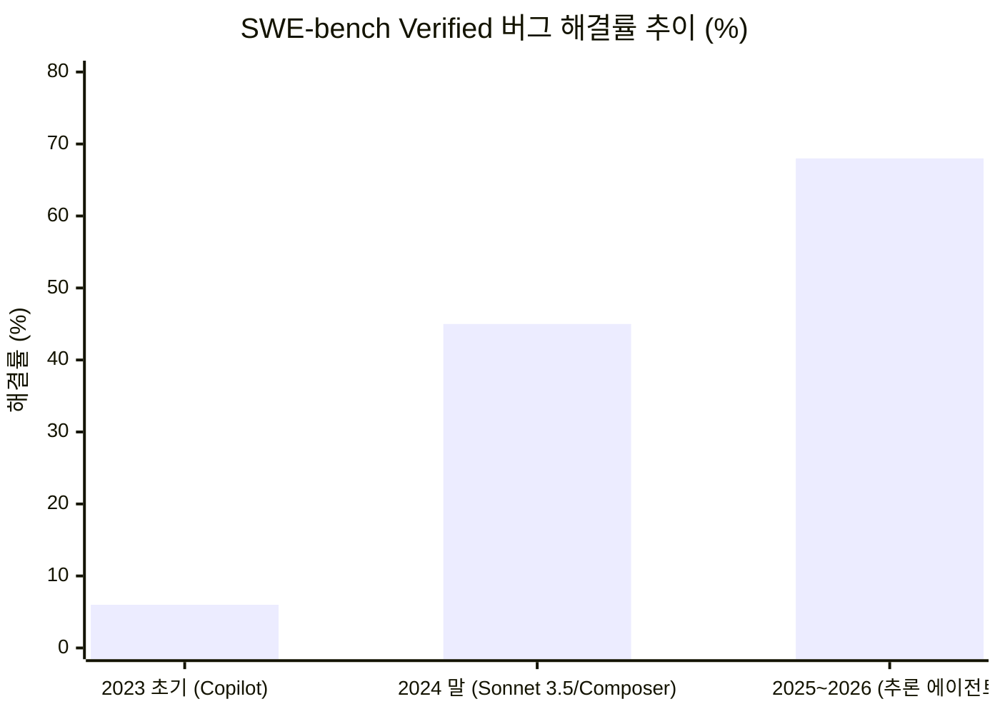
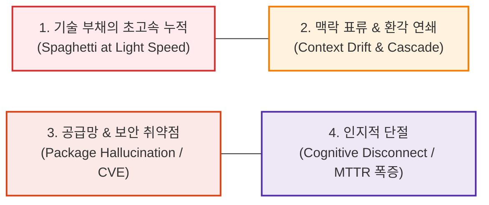

# [발표 슬라이드] 바이브 코딩(Vibe Coding)의 엔지니어링 분석 및 엔터프라이즈 도입 전략

> **기반 문서**: [기술 보고서 TR-2026-AI-003](file:///c:/Users/상투/Documents/vibe-coding/ch03/what-%20is%20-vibecoding/vibe_coding_technical_report.md)  
> **발표자**: 시니어 AI 엔지니어 / AI 시스템 아키텍트  
> **장표 구성**: 핵심 내용을 응축한 총 10개 정예 슬라이드 (발표자 노트 포함)  

---

## Slide 1. 패러다임의 대전환 (Title & Context)

### "코드 작성을 넘어 '의도(Intent) 기반 자율 소프트웨어 합성'의 시대로"

* **발표 주제**: 바이브 코딩의 기술적 기저 메커니즘과 엔터프라이즈 거버넌스
* **기반 기술 보고서**: `TR-2026-AI-003` (Approved)
* **핵심 화두**:
  - 단순 코드 자동완성(Autocomplete) 시대의 종언
  - 자연어 명세 $\rightarrow$ 다중 파일 자율 합성 $\rightarrow$ 런타임 자가 치유(Self-Healing)
  - 엔터프라이즈 프로덕션 환경에서의 속도와 신뢰성 양립 과제

> 🎙️ **발표자 노트 (Speaker Notes)**  
> "반갑습니다. 오늘 발표는 최근 테크 업계의 가장 뜨거운 화두인 '바이브 코딩'을 시니어 AI 엔지니어의 시각에서 냉정하게 해부하는 자리입니다.  
> 단순한 개인의 생산성 팁을 넘어, 이것이 소프트웨어 공학의 아키텍처를 어떻게 근본적으로 재편하고 있는지, 그리고 우리 조직이 이를 안전하게 도입하기 위해 어떤 4단계 가드레일을 갖춰야 하는지 핵심 위주로 명확히 전달해 드리겠습니다."

---

## Slide 2. 본질 정의: Software 3.0과 패러다임 시프트

### "구현(Implementation)은 AI에게 수렴하고, 엔지니어링은 명세와 검증으로 진화한다"

```
[Software 1.0]  인간이 논리와 문법을 직접 작성 (C, Java, Python)
[Software 2.0]  인간이 네트워크 구조를 설계하고 데이터로 가중치(Weights) 최적화 (Deep Learning)
[Software 3.0]  자연어 의도(Intent)가 코드가 되고, LLM 에이전트가 컴파일러이자 실행 엔진이 됨 (Vibe Coding)
```

* **바이브 코딩의 공학적 정의**:  
  자연어로 표현된 고수준의 요구사항과 제약조건을 입력받아, AI 에이전트가 코드베이스를 조작하고 런타임 에러를 스스로 해결하며 결과물을 완성하는 **'의도 중심 자율 개발(Intent-Driven Autonomous SWE)'**.
* **역할의 전환**:
  - **As-Is**: 개발자 = 컴퓨터 언어로 번역하는 번역가 (Code Writer)
  - **To-Be**: 개발자 = 시스템 경계와 제약조건을 정의하는 발주자이자 아키텍트 (System Director & Evaluator)

> 🎙️ **발표자 노트 (Speaker Notes)**  
> "과거 카파시가 딥러닝을 Software 2.0이라 명명했듯, 바이브 코딩은 진정한 의미의 Software 3.0입니다.  
> 가장 인기 있는 프로그래밍 언어가 '자연어'가 되었습니다. 문법을 외우고 타이핑하는 데 들던 인지 부하는 이제 0으로 수렴하고 있습니다. 엔지니어의 역할은 저수준 코더에서 시스템의 의도와 제약조건을 설정하는 '총괄 디렉터'로 완전히 도약했습니다."

---

## Slide 3. 시스템 아키텍처: 전통적 개발 vs 바이브 코딩 에이전트

### "인간 중심의 단일 병목 루프에서 '인간 감독 하의 자율 에이전트 루프'로"

```
[전통적 개발 프로세스 (인간이 모든 병목 담당)]
인간 (설계 & 로직) ──> 인간 (키보드 코딩) ──> 컴파일/런타임 ──> 에러 로그 ──> 인간 (디버깅/검색)

[바이브 코딩 에이전트 아키텍처 (자가 치유 폐루프)]
인간 (의도 & 제약조건 지시) 
       │
       ▼
[ Context Orchestrator ] ──(AST/코드 인덱싱)──> [ LLM 추론 코어 ]
                                                        │ (Tool Call / MCP)
                                                        ▼
[ 샌드박스 런타임 ] ──(stdout/stderr 로그 역주입)── [ 파일/셸 I/O 하네스 ]
       │                      ▲
       └─ [ 자가 치유 루프 ] ─┘
```

* **전통적 방식**: 코드 작성부터 에러 구글링, 디버깅까지 인간이 전 과정의 물리적 병목(Bottleneck).
* **바이브 코딩**: AI가 '코드 합성 $\rightarrow$ 셸 빌드 $\rightarrow$ 에러 포착 $\rightarrow$ 자가 수정' 루프를 무인 완결. 인간은 승인/반려 게이트만 통제.

> 🎙️ **발표자 노트 (Speaker Notes)**  
> "이 다이어그램이 아키텍처의 핵심입니다. 왼쪽의 전통적 방식에서는 모든 과정에 사람이 개입해 병목이 발생했습니다.  
> 반면 바이브 코딩 에이전트는 파일 시스템과 셸을 직접 다루는 하네스를 쥐고 있습니다. 에러가 나면 스스로 트레이스백을 읽어 코드를 고치는 '자가 치유(Self-Healing)' 루프를 돕니다. 인간은 시스템 상단에서 목표를 제시하고 최종 검증만 수행합니다."

---

## Slide 4. 기저 기술 해체: 에이전트를 지탱하는 4대 컴포넌트

### "단순 텍스트 생성을 넘어 온전한 '자율 소프트웨어 합성'을 가능케 한 4대 축"

| 컴포넌트 | 핵심 메커니즘 | 공학적 기여 및 효과 |
| :--- | :--- | :--- |
| **1. Context Engine** | • AST(추상 구문 트리), Git 히스토리 인덱싱<br>• 1M~2M 대형 컨텍스트 윈도우 인메모리 탑재 | RAG의 단편적 검색 한계 극복, 수만 줄의 프로젝트 전체 아키텍처 일관성 유지 |
| **2. Reasoning Core** | • Chain-of-Thought (CoT) 다단계 심층 추론<br>• 요구사항 $\rightarrow$ 아키텍처 $\rightarrow$ 구현 분해 | 단순 패턴 매칭을 넘어선 복합 의존성 분석 및 엣지 케이스 자율 처리 |
| **3. Execution Harness** | • MCP (Model Context Protocol) 표준 연동<br>• 가상 샌드박스 터미널/패키지 관리자 제어 | 모델이 텍스트 출력에 머물지 않고 실제 빌드, 테스트, 환경 설정을 직접 수행 |
| **4. Self-Healing Loop** | • stderr / stdout 표준 에러 스트림 역주입<br>• 1~3회 무인 컴파일/린트 자율 교정 | 사소한 문법 및 런타임 에러로 인한 개발자 개입 피로도 90% 제거 |

> 🎙️ **발표자 노트 (Speaker Notes)**  
> "왜 2025~2026년에 와서야 바이브 코딩이 가능해졌을까요? 4가지 기술이 결합했기 때문입니다.  
> 전체 코드베이스를 한 번에 조망하는 컨텍스트 엔진, 복잡한 설계도를 그리는 추론 코어, 안전하게 셸과 도구를 실행하는 MCP 하네스, 그리고 에러를 스스로 수정하는 자가 치유 루프입니다. 이 4개가 맞물려 실질적인 '자율 개발'이 완성되었습니다."

---

## Slide 5. 정량 벤치마크: 생산성 혁신과 토큰 경제학

### "SWE-bench Verified 65%+ 달성 및 10~30배의 압도적 ROI"



* **개발 주기(Lead Time) 절감 효과**:
  - **신규 기능 프로토타이핑**: 기존 대비 **70~85% 시간 절감**
  - **보일러플레이트 작성 & 마이그레이션**: **90% 이상 절감**
  - **단위 테스트 코드 작성**: **80% 절감**
* **토큰 경제성 (Token Economics)**:
  - 시니어 엔지니어 시간당 단가: 약 **\$50 ~ \$150/hr**
  - 1회 기능 구현 세션당 추론 API 비용: **\$0.50 ~ \$3.00**
  - **결론**: 개발 시간 절감 대비 API 비용을 상계한 초기 투자 수익률(ROI)은 최소 **10배 ~ 30배** 이상.

> 🎙️ **발표자 노트 (Speaker Notes)**  
> "SWE-bench 지표를 보십시오. 실제 깃허브 오픈소스 버그를 해결하는 능력이 3년 만에 6%에서 68%로 수직 상승했습니다.  
> 실제 현업에서도 신규 기능 프로토타이핑 시간이 80% 가까이 줄었습니다. 엔지니어 1시간 인건비 대비 단돈 몇 달러의 API 비용으로 수시간의 작업을 끝내기 때문에, 정량적 ROI는 10배에서 30배에 달합니다."

---

## Slide 6. 리스크 진단: 엔터프라이즈 환경에서의 4대 치명적 위험

### "통제 없는 바이브 코딩은 '빛의 속도로 기술 부채를 양산'한다"



1. **기술 부채의 급속 누적**: AI는 단기 동작에만 집착하여 전역 상태 오용, 결합도(Coupling) 급증 초래.
2. **맥락 표류 및 환각 연쇄**: 대화가 길어지면 아키텍처 원칙을 망각하고, 임시방편(Monkey Patch) 패치로 구조 파괴.
3. **공급망 공격 & 시크릿 유출**: 존재하지 않는 가짜 패키지 환각으로 악성코드 침투 위험, API Key 하드코딩.
4. **인지적 단절 (Cognitive Disconnect)**: 코드가 블랙박스화되어 장애 발생 시 평균 복구 시간(MTTR) 급증.

> 🎙️ **발표자 노트 (Speaker Notes)**  
> "그러나 우리는 장밋빛 환상만을 보아서는 안 됩니다.  
> AI는 가장 손쉬운 지름길을 택하기 때문에 스파게티 코드를 빛의 속도로 양산합니다. 또한 긴 대화 속에서 환각이 꼬리를 물고, 가짜 라이브러리를 설치하거나 시크릿을 노출하는 보안 사고가 발생합니다. 무엇보다 개발자가 코드를 이해하지 못해 장애 발생 시 서비스 복구가 마비되는 인지적 단절이 가장 치명적입니다."

---

## Slide 7. 가드레일 아키텍처: 3단계 방어 파이프라인

### "자유로운 바이브 코딩을 허용하되, 배포 게이트는 기계적으로 통제한다"

```mermaid
flowchart LR
    subgraph Phase1["[ 1단계: 개발 환경 ]"]
        direction TB
        A["인간 의도 (Intent)"] --> B[".cursorrules / CLAUDE.md<br>(아키텍처 제약 강제)"]
        B --> C["AI 에이전트 자율 합성"]
    end

    subgraph Phase2["[ 2단계: 자동화 가드레일 ]"]
        direction TB
        C --> D["Pre-commit AST / Lint<br>(정적 코드 분석)"]
        D --> E["Test-Driven Verification<br>(단위 / E2E 테스트 통과)"]
        E --> F["SAST / SCA 보안 스캔<br>(시크릿 / 의존성 검사)"]
    end

    subgraph Phase3["[ 3단계: 프로덕션 게이트 ]"]
        direction TB
        F --> G["인간 아키텍트 코드 리뷰<br>(PR 승인 게이트)"]
        G --> H["프로덕션 무결점 배포"]
    end

    style Phase1 fill:#e8f5e9,stroke:#2e7d32
    style Phase2 fill:#fff3e0,stroke:#e65100
    style Phase3 fill:#e3f2fd,stroke:#1565c0
```



* **핵심 전략**: 에이전트의 생성 자유도를 억압하지 않고, **자동화된 검증 파이프라인(CI/CD Gate)**을 통과해야만 머지가 가능하도록 강제.

> 🎙️ **발표자 노트 (Speaker Notes)**  
> "그렇다면 이 리스크를 어떻게 제어할 것인가? 바로 이 3단계 파이프라인입니다.  
> 1단계에서 규칙 파일로 에이전트에게 가이드라인을 주고, 2단계에서 커밋과 PR 시 린터, 테스트 슈트, 보안 스캐너가 자동으로 무결성을 검증합니다. 그리고 마지막 3단계에서 인간 아키텍트가 최종 승인해야만 프로덕션에 나갈 수 있습니다."

---

## Slide 8. 실전 4대 방어선 상세 전략 (Deep Dive)

### "프로덕션 레벨 품질을 담보하는 4가지 구체적 엔지니어링 실천 규약"

```
[제1방어선: 컨텍스트 룰셋 표준화]
• .cursorrules, CLAUDE.md를 기계 판독 가능한 마크다운으로 프로젝트 루트에 배치
• 상태 관리 패턴, 허용 라이브러리, 모듈당 최대 라인 수(150줄 제한) 강제

[제2방어선: 테스트 주도 에이전트 검증 (TDD-First)]
• "기능 코드를 작성하기 전, 반드시 실패하는 단위 테스트와 E2E 케이스를 먼저 작성하라"
• 코드를 인간이 다 읽지 않더라도, 100% 테스트 패스(Green Light)로 논리적 무결성 증명

[제3방어선: CI/CD 정적 및 보안 분석 게이트]
• Snyk / Trivy: 오픈소스 의존성 취약점 및 미승인 라이선스 자동 차단
• GitGuardian: 하드코딩된 API Key 및 자격 증명 발견 시 커밋 즉시 블로킹
• SonarQube: 순환 복잡도(Cyclomatic Complexity) 및 코드 중복률 엄격 제한

[제4방어선: 마이크로 커밋 거버넌스 (Micro-Commit)]
• 다중 파일 일괄 수정(Big Bang Change) 엄격 제한
• 1개 기능 = 1개 원자적 Git 커밋 원칙 준수 ──> 문제 발생 시 즉각적인 롤백 보장
```

> 🎙️ **발표자 노트 (Speaker Notes)**  
> "실무에서 즉시 적용할 수 있는 4대 방어선입니다.  
> 첫째, 룰셋 파일로 컴포넌트 크기와 규칙을 강제합니다.  
> 둘째, TDD입니다. 에이전트에게 테스트 코드를 먼저 짜게 하고 이를 통과하게 만들면 환각을 원천 차단합니다.  
> 셋째, CI/CD에서 취약점과 API Key 노출을 기계적으로 차단합니다.  
> 넷째, 기능 하나당 1개의 깃 커밋을 남겨 언제든 안전하게 이전 상태로 되돌릴 수 있는 원자적 변경을 유지해야 합니다."

---

## Slide 9. 엔터프라이즈 도입 로드맵: 3단계 점진적 확산

### "도메인 리스크 수준에 맞춘 안전하고 점진적인 채택 전략"

| 단계 | 적용 도메인 (Risk) | 핵심 적용 가드레일 | 권장 도구 및 모델 |
| :--- | :--- | :--- | :--- |
| **1단계: 즉시 도입**<br>(Low Risk) | • 사내 업무 자동화 스크립트<br>• 데이터 시각화 & 마이크로 툴<br>• UI 프로토타이핑 | 기본 프롬프트 템플릿, 로컬 샌드박스 격리 | Cursor, Bolt.new, Claude 3.5 Sonnet |
| **2단계: 가드레일 적용**<br>(Medium Risk) | • 고객용 웹 서비스 프론트엔드<br>• 백엔드 CRUD 보일러플레이트<br>• 레거시 코드 리팩토링 & 테스트 작성 | .cursorrules 룰셋 적용, CI/CD 보안 스캔, TDD 의무화 | Cursor / Windsurf + GitHub Actions CI |
| **3단계: 보수적 접근**<br>(High / Mission-Critical) | • 금융 결제 및 트랜잭션 코어<br>• 대규모 분산 동기화 인프라<br>• 인증/인가 및 개인정보 모듈 | 정형 검증(Formal Methods), 이중 시니어 코드 리뷰, 카나리 배포 | Claude Code, 특화 추론 모델 + 도메인 아키텍트 전담 |

> 🎙️ **발표자 노트 (Speaker Notes)**  
> "기업 도입은 3단계로 가야 합니다.  
> 1단계는 사내 자동화 툴이나 프로토타입 같은 저위험 영역에 전면 도입하여 생산성을 극대화합니다.  
> 2단계는 가드레일을 장착한 뒤 웹 UI나 일반 CRUD API에 적용합니다.  
> 결제나 개인정보 같은 3단계 핵심 영역은 AI에게 초안만 맡기고, 반드시 시니어 아키텍트의 정밀 리뷰와 정형 검증을 병행하는 보수적 접근을 고수해야 합니다."

---

## Slide 10. 결론: 차세대 엔지니어링 패러다임

### "Don't just vibe. Direct with engineering rigor."
*(단순히 분위기만 타지 마십시오. 엔지니어링의 엄밀함으로 지휘하십시오.)*

```
1. 패러다임의 불가역성
   - 바이브 코딩은 일시적 유행이 아닌, 어셈블리어에서 고급 언어로 넘어갔던 것과 같은 
     소프트웨어 공학의 '불가역적 추상화 도약'입니다.

2. 엔지니어의 핵심 경쟁력 재정의
   - 과거: 문법 암기 및 코드 작성 속도 (Typing)
   - 미래: 명세 정의(Specification), 시스템 아키텍처 설계, 자동화 검증(Verification) 능력

3. 경영진 및 엔지니어링 리더를 위한 최종 제언
   - 생성 속도는 AI에게 일임하십시오.
   - 신뢰성과 거버넌스는 엔지니어링 가드레일로 통제하십시오.
```

> 🎙️ **발표자 노트 (Speaker Notes)**  
> "마지막 결론입니다. 어셈블리어에서 C언어로, C언어에서 파이썬으로 발전했듯, 자연어로 소프트웨어를 합성하는 바이브 코딩은 되돌릴 수 없는 역사의 흐름입니다.  
> 이제 엔지니어의 실력은 '코드를 얼마나 빨리 치느냐'가 아니라 'AI에게 시스템의 경계를 얼마나 정확히 지시하고, 그 결과물을 얼마나 날카롭게 검증해내느냐'에 달려 있습니다.  
> 속도는 AI의 바이브에 맡기되, 품질은 우리 엔지니어의 엄밀함으로 완성해야 합니다. 경청해 주셔서 감사합니다."
